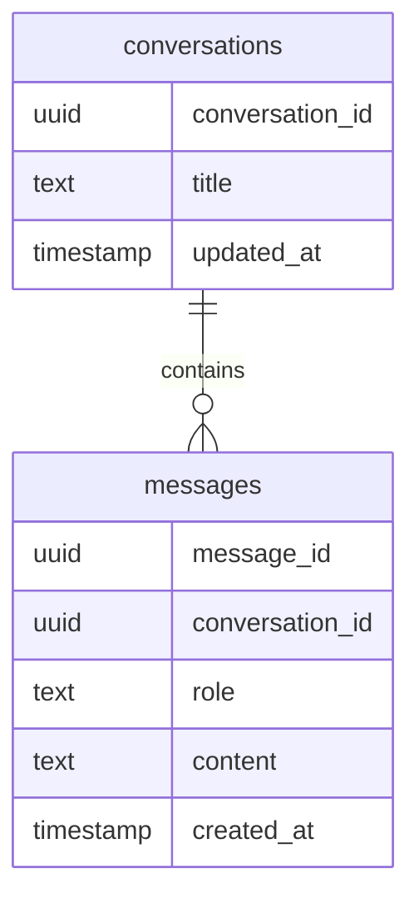

# Kairo

Kairo is an AI-powered conversational assistant built as a React web application. It gives authenticated users a focused workspace for creating named conversations, revisiting chat history, sending messages, and attaching common image or document files for backend processing.

The repository contains the Vite frontend and its Supabase client integration. The frontend expects a deployed Supabase project with the required database tables, Storage policies, and a `chat` Edge Function. The Edge Function implementation, SQL migrations, and provider-specific AI code are not included in this repository.

## Features

- **Authentication**
  - Email/password sign-up and sign-in through Supabase Auth.
  - Google sign-in using a Google credential and Supabase `signInWithIdToken`.
  - Supabase session rehydration on page load and synchronization through `onAuthStateChange`.
  - Protected chat routes and redirects for authenticated and unauthenticated users.
  - Email confirmation is required by the sign-up service before a new account can sign in.
- **Conversation workspace**
  - Create a conversation with a custom title.
  - Browse previous conversations in a responsive sidebar.
  - Load up to the latest 50 stored messages for a conversation.
  - Optimistic rendering of outgoing messages and an in-progress assistant indicator.
  - Enter-to-send behavior, multiline input with `Shift+Enter`, and responsive mobile navigation.
- **File attachments**
  - Supported extensions: `png`, `jpg`, `jpeg`, `webp`, `gif`, `pdf`, `docx`, and `txt`.
  - Images are limited to 10 MB; other supported files are limited to 15 MB.
  - Files are uploaded to the `kairo-private` Supabase Storage bucket before the chat request is sent.
  - Attachment metadata sent to the chat function includes the Storage path, original filename, and MIME type.
  - Users can cancel an uploaded attachment; the frontend checks that deletion paths belong to the current user's conversation.
  - Image understanding and document extraction are expected to be performed by the deployed backend function. Their model and parser implementation is not present in this repository.
- **UI and reliability**
  - Responsive layout with a desktop conversation sidebar and mobile drawer.
  - Markdown-like message rendering with copy-to-clipboard support where available in the message component.
  - Loading, upload, validation, and send-error states.
  - Toast notifications for authentication, upload, conversation, and message failures.
  - Accessible labels, keyboard interactions, and a visible reminder that AI responses may be incorrect.

## Technology stack

| Area | Technology | Role |
| --- | --- | --- |
| Frontend | React 19 | Component-based application UI |
| Build tooling | Vite 8 | Development server and production bundling |
| Routing | React Router | Routes for home, authentication, new chat, and conversation pages |
| State | Redux Toolkit and React Redux | Client-side authentication state |
| Styling | Tailwind CSS 4 with the Vite plugin | Utility styling and responsive layout |
| UI | Radix-style local UI components, `lucide-react`, `sonner` | Controls, icons, and notifications |
| Forms | `react-hook-form` | Login and registration form handling |
| Backend client | `@supabase/supabase-js` | Auth, Postgres queries, Storage, and Edge Function invocation |
| Deployment | Vercel-compatible Vite deployment | Static frontend hosting |

The repository does not include Cohere SDK/API calls. If the deployed `chat` Edge Function uses Cohere, that provider configuration belongs to the Supabase backend deployment rather than this frontend repository.

## Architecture

```text
React/Vite frontend
        |
        +--> Supabase Auth
        |       +--> Email/password
        |       +--> Google ID-token sign-in
        |
        +--> Supabase Postgres
        |       +--> conversations
        |       +--> messages
        |
        +--> Supabase Storage
        |       +--> kairo-private (conversation files)
        |       +--> kairo-public (profile pictures, service support)
        |
        +--> Supabase Edge Function: chat
                +--> Backend AI/provider processing
                +--> Stores user and assistant messages
                +--> Returns { reply, userMessageId, messageId }
```

The frontend creates conversations and reads conversation/message data directly through the Supabase client. It invokes the `chat` Edge Function for message generation. Because the function source is not in this repository, its session validation, ownership checks, AI provider calls, document extraction, response persistence, and API logging must be verified and maintained in the separately deployed Supabase project.

### Text message flow

1. A user enters text in `/chat/:conversation_id`.
2. The frontend invokes the `chat` function with `conversationId`, `message`, and an optional attachment.
3. The function is expected to authenticate the request, validate conversation ownership, persist the user message, generate a response, persist the assistant message, and return the response payload.
4. The frontend replaces its temporary user-message ID and appends the returned assistant reply.

### Attachment flow

1. The user selects a supported file.
2. The frontend validates its extension and size.
3. The file is uploaded to `kairo-private` at:
   `user-id/conversations/conversation-id/documents/uuid-original-name`
4. The resulting Storage path is sent to the `chat` function as attachment metadata.
5. Backend processing is outside this repository. The frontend does not itself extract document text or call a vision/text model.

## Database design

The frontend queries two tables by name:

- **`conversations`**: stores conversation identifiers, titles, and an `updated_at` value used to order the sidebar.
- **`messages`**: stores `message_id`, `conversation_id`, `role`, `content`, and `created_at`. Messages are loaded by conversation and ordered by creation time.

The expected relationship is:



This diagram reflects only columns referenced by the frontend. No schema migration or database definition is included in the repository, so types, foreign keys, indexes, RLS policies, attachment tables, and API-log tables must be documented from the actual Supabase project before production deployment.

## Storage architecture

The frontend references two buckets:

- **`kairo-private`**: conversation attachments. Upload paths are scoped under the authenticated user's ID and conversation ID.
- **`kairo-public`**: profile-picture service support. The profile-picture helper uses `profile-pictures/user-id/uuid-original-name`.

The repository does not include Storage policies. Configure private-bucket read/write/delete policies in Supabase so users can access only their own paths. Use the public bucket only where public access is intentional.

## Security notes

Implemented in the frontend:

- Supabase Auth manages sessions and tokens.
- Redux auth state is rehydrated from the Supabase session and updated on auth changes.
- Protected routes redirect unauthenticated users to `/login`.
- Attachment extension and size validation occurs before upload.
- Attachment deletion checks that the requested path starts with the current user's conversation prefix.
- Supabase URL and publishable key are read from Vite environment variables.

Required backend controls:

- Enable Row Level Security and ownership policies for conversations and messages.
- Enforce session validation and conversation ownership in the `chat` Edge Function.
- Keep AI provider keys in Supabase Edge Function secrets, never in `VITE_*` variables.
- Configure Storage policies for `kairo-private` and review whether `kairo-public` should be public.

The repository does not expose implementation for RLS, Edge Function authorization, file scanning, rate limiting, API logging, or provider error handling. These should not be assumed to exist until confirmed in the Supabase project.

## Project structure

```text
.
├── public/
│   ├── png/ and svg/       # Kairo branding and favicon assets
│   └── profile.jpg         # Public profile asset
├── src/
│   ├── components/         # Layout, auth, chat, sidebar, and UI components
│   ├── lib/                # Notifications and shared utilities
│   ├── pages/              # Home, auth, new-chat, and chat routes
│   ├── store/              # Redux store and authentication slice
│   ├── supabase/           # Auth and database/storage service wrappers
│   ├── App.jsx             # Session synchronization and app outlet
│   ├── main.jsx            # Router and Redux provider setup
│   ├── App.css
│   └── index.css
├── supabaseConfig.js       # Supabase browser client
├── vite.config.js          # Vite, Tailwind, alias, and dev-server settings
├── vercel.json             # SPA rewrite for Vercel
├── package.json
└── .gitignore
```

There is currently no `supabase/` migrations or Edge Function directory in this repository.

## Local development

### Prerequisites

- Node.js and npm
- Git
- A Supabase project
- A configured backend AI provider for the deployed `chat` function

### Clone and install

```bash
git clone https://github.com/syedsuhaibhasan/kairo.git
cd kairo
npm install
```

### Configure environment variables

Create `.env.local` in the repository root:

```dotenv
VITE_SUPABASE_URL=https://your-project.supabase.co
VITE_SUPABASE_PUBLISHABLE_KEY=your-supabase-publishable-key
```

These are the only frontend environment variables referenced by the source. Do not put an AI provider secret in this file. Configure backend secrets in Supabase Edge Function settings.

### Run the app

```bash
npm run dev
```

The Vite server uses port `5173` and requires that port to be available.

### Build and preview

```bash
npm run build
npm run preview
```

The available package scripts are `dev`, `build`, `lint`, and `preview`.

## Supabase setup

The frontend assumes the following external configuration:

1. Create a Supabase project.
2. Set `VITE_SUPABASE_URL` and `VITE_SUPABASE_PUBLISHABLE_KEY` locally and in the frontend deployment.
3. Enable Email provider authentication and configure email confirmation behavior.
4. Enable Google provider authentication and configure Google OAuth credentials and redirect URLs.
5. Create the `conversations` and `messages` tables with the columns used by the frontend.
6. Enable RLS and add policies that scope rows to the authenticated user.
7. Create `kairo-private` and configure private Storage policies for user conversation paths.
8. Create/configure `kairo-public` only if profile-picture functionality is required.
9. Deploy the `chat` Edge Function.
10. Configure the function's AI-provider secret and any required backend settings.

No SQL migrations, Edge Function source, or Storage policy definitions are included here. Do not run guessed migration commands; use the schema and function source from the Supabase project that backs the application.

## AI configuration

The frontend sends chat requests to the Supabase function named `chat`; it does not select models or call an AI provider directly. The repository therefore cannot verify the text model, vision model, document parser, Cohere trial configuration, rate-limit behavior, or provider error mapping.

If the deployed function uses Cohere, configure its API key as a Supabase Edge Function secret and keep model selection, image understanding, document extraction, and provider error handling server-side. Trial credentials are suitable for development/evaluation only and should not be treated as a commercial production capacity plan.

## Deployment

### Frontend on Vercel

1. Import the GitHub repository into Vercel.
2. Select Vite or configure the project manually.
3. Set the root directory to `./`.
4. Use `npm run build` as the build command.
5. Use `dist` as the output directory.
6. Add `VITE_SUPABASE_URL` and `VITE_SUPABASE_PUBLISHABLE_KEY` as production environment variables.
7. Configure Supabase and Google OAuth redirect URLs for the production Vercel origin.

`vercel.json` rewrites all routes to `index.html`, which supports the client-side React Router routes. Supabase remains the backend; its Auth, Storage, database, and Edge Functions are not deployed to Vercel.

## Screenshots

The repository contains Kairo logos, icons, and a hero asset, but no application screenshots. Add real screenshots here when available, for example:

```text
docs/screenshots/new-chat.png
docs/screenshots/conversation.png
docs/screenshots/mobile-sidebar.png
```

Do not use the branding assets as substitutes for product screenshots.

## Future improvements

- Add the Supabase schema, RLS policies, and Edge Function source or a reproducible backend deployment guide.
- Add OCR and more robust extraction for scanned or complex PDFs.
- Add conversation search and filtering.
- Stream assistant responses instead of waiting for a complete function response.
- Improve attachment previews and expose persisted attachment metadata in chat history.
- Add explicit backend rate-limit handling and API usage observability.
- Support additional AI providers behind the backend function.

## License

No license file is currently included. Add a license before accepting external contributions or redistributions.
